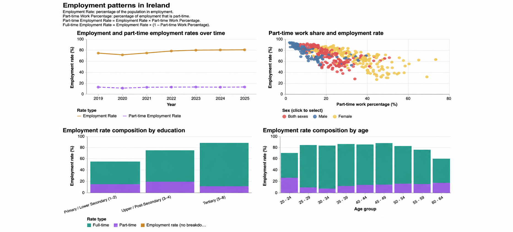

# Employment Patterns in Ireland

An interactive Vega-Lite dashboard exploring employment rates, part-time work, and demographic patterns in Ireland from 2019 to 2025.

## Data sources

The data comes from Central Statistics Office (CSO) High Value Datasets: annual employment rates and [ALF02 Annual Percentage of Part-time Work](https://data.cso.ie/table/ALF02). The project keeps national records for Ireland and joins the datasets by year, age, sex, and education level. Part-time and full-time employment rates are derived from the two source percentages; missing values are not replaced with zero. See the [data-cleaning](datacleaning_alf02.ipynb) and [data-preparation](dataprepare.ipynb) notebooks.

## Charts

1. **Time-series chart:** compares annual employment and part-time employment rates.
2. **Scatter plot:** shows the relationship between the part-time work share and employment rate, with colour identifying sex categories.
3. **Education chart:** compares full-time and part-time employment composition across education levels.
4. **Age chart:** compares employment composition across age groups.

## Interaction design

Click a year in the time-series chart, a scatter-plot legend item, or a category in either bar chart to filter all four views. Unmatched scatter points remain grey to preserve the overall distribution. Click the active selection again to clear it, and hover over marks for detailed values. See [`interactive.vl.json`](interactive.vl.json) for the complete implementation.
